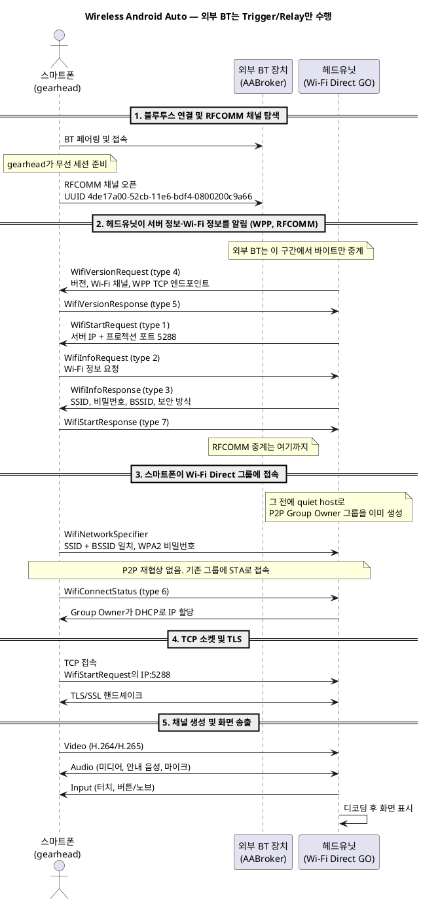

# Wireless Android Auto 동작 과정

외부 BT 장치(AABroker)가 **초기 접속 정보 전달(Trigger / Relay)** 만 할 때, 스마트폰이 헤드유닛 서버에 접속하기까지의 핸드셰이크입니다.

## 주체

| 주체 | 하는 일 |
|---|---|
| **스마트폰** | Android Auto 서비스 `com.google.android.projection.gearhead`가 RFCOMM을 열고, Wi-Fi에 붙고, 헤드유닛 서버로 TCP/TLS 프로젝션을 시작합니다. |
| **외부 BT 장치** | RFCOMM 바이트를 중계합니다. Wi-Fi·서버 정보의 출처가 아닙니다. |
| **헤드유닛** | Wi-Fi Direct Group Owner로 그룹을 연 뒤, WPP로 **서버 주소**와 **그룹 접속 정보**를 스마트폰에 알립니다. 이후 영상 스트림을 받아 화면에 그립니다. |

## 순서

---

### 1단계 — 블루투스 연결 및 RFCOMM 채널 탐색

**주체: 스마트폰 → 외부 BT 장치**

1. **스마트폰**이 **외부 BT 장치**에 페어링되어 접속합니다.
2. **스마트폰 OS**의 Android Auto 서비스(`com.google.android.projection.gearhead`)가 무선 세션을 준비합니다.
3. **스마트폰**이 Android Auto 무선 서비스 UUID `4de17a00-52cb-11e6-bdf4-0800200c9a66`로 **외부 BT 장치**의 RFCOMM 시리얼 채널을 엽니다.

이 단계의 결과는 BT 위의 양방향 직렬 채널입니다. Wi-Fi와 TCP는 아직 없습니다.

---

### 2단계 — 헤드유닛이 서버 정보와 Wi-Fi 정보를 알림

**주체: 헤드유닛 → 스마트폰** (RFCOMM 바이트는 **외부 BT 장치**가 중계)

프로젝트 4의 Wi-Fi Projection Protocol(`WppHandshakeSession`)은 접속 정보를 한 번에 넣지 않습니다. **서버 주소**와 **Wi-Fi 정보**는 헤드유닛이 서로 다른 메시지로 보냅니다.

1. **헤드유닛**이 `WifiVersionRequest`(type 4)를 보냅니다. 프로토콜 버전, 지원 Wi-Fi 채널, 이후 재접속용 WPP TCP 엔드포인트가 들어갑니다.
2. **스마트폰**이 `WifiVersionResponse`(type 5)로 응답합니다.
3. **헤드유닛**이 `WifiStartRequest`(type 1)로 **서버 정보**를 알립니다. 프로젝션을 열 IP와 포트입니다. 이 앱은 `ip`와 **5288**을 넣습니다.
4. **스마트폰**이 `WifiInfoRequest`(type 2)로 Wi-Fi 정보를 요청합니다. 헤드유닛이 먼저 SSID를 밀어 넣지 않습니다.
5. **헤드유닛**이 `WifiInfoResponse`(type 3)로 **Wi-Fi 정보**를 알립니다.

| 메시지 | 방향 | 담는 정보 |
|---|---|---|
| `WifiStartRequest` (1) | 헤드유닛 → 스마트폰 | 서버 IP, 프로젝션 포트 **5288** |
| `WifiInfoRequest` (2) | 스마트폰 → 헤드유닛 | Wi-Fi 정보 요청 |
| `WifiInfoResponse` (3) | 헤드유닛 → 스마트폰 | 그룹 SSID, 비밀번호, BSSID, WPA2 |
| `WifiVersionRequest` (4) | 헤드유닛 → 스마트폰 | 버전, Wi-Fi 채널 목록, WPP TCP 주소(재접속용) |

6. **스마트폰**이 `WifiStartResponse`(type 7)로 시작 요청을 확인합니다.

이미 같은 Wi-Fi Direct 그룹에 붙어 있으면 스마트폰은 2·3을 건너뛰고 7과 접속 상태만 보냅니다. **외부 BT 장치**는 이 메시지들을 실어 나를 뿐이고, 2단계가 끝나면 더 이상 개입하지 않습니다.

---

### 3단계 — 스마트폰이 Wi-Fi Direct 그룹에 접속

**주체: 스마트폰 → 헤드유닛(Group Owner)**

Wi-Fi Direct에서도 스마트폰은 헤드유닛과 P2P 협상을 다시 하지 않습니다. 헤드유닛이 먼저 그룹을 만들고, 스마트폰은 그 그룹에 Wi-Fi 클라이언트(STA)로 붙습니다.

**그룹 생성 (2단계 메시지보다 앞)**

1. **헤드유닛**의 `WifiDirectManager.startNativeAaQuietHost()`가 `WifiP2pManager.createGroup()`으로 자율 Group Owner 그룹을 만듭니다. 피어 탐색 루프는 없습니다(quiet host).
2. 그룹에는 `networkName`(SSID), WPA2 passphrase, BSSID, 동작 대역(2.4 또는 5 GHz), Group Owner IP가 있습니다.
3. 이 값이 2단계 `WifiInfoResponse`와 `WifiStartRequest`에 들어갑니다. SSID·비밀번호·BSSID는 같은 그룹의 한 스냅샷이어야 합니다. Gearhead는 SSID와 BSSID를 모두 맞춰 보고, 서로 다른 그룹의 값이 섞이면 접속을 거절합니다.

**스마트폰의 접속**

1. **스마트폰** Android Auto(`gearhead`)가 Wi-Fi를 켜고 `WifiNetworkSpecifier`로 접속합니다. 조건은 `WifiInfoResponse`의 SSID, BSSID(전체 마스크), WPA2 비밀번호입니다.
2. **스마트폰**은 새 P2P 그룹을 제안하지 않고, 이미 떠 있는 헤드유닛 그룹에 클라이언트로 associate 합니다.
3. **스마트폰**이 `WifiConnectStatus`(type 6)로 결과를 **헤드유닛**에 알립니다.
4. **헤드유닛 Group Owner**가 DHCP로 **스마트폰**에 주소를 줍니다. 이후 TCP는 Group Owner IP와 포트 5288로 갑니다.

---

### 4단계 — TCP 접속 및 TLS 세션

**주체: 스마트폰 → 헤드유닛 서버**

1. **스마트폰**이 `WifiStartRequest`로 받은 주소로 TCP 소켓을 엽니다. 예: `192.168.43.1:5288`.
2. **스마트폰**과 **헤드유닛 서버**가 Android Auto 규격에 따라 TLS/SSL 키 교환을 하고 보안 터널을 만듭니다.

---

### 5단계 — 채널 생성 및 화면 송출

**주체: 스마트폰 ↔ 헤드유닛 서버**

TLS 터널이 열린 뒤 **스마트폰**과 **헤드유닛 서버**가 채널을 나눕니다.

| 채널 | 방향 | 내용 |
|---|---|---|
| Video | 스마트폰 → 헤드유닛 | H.264 / H.265 화면 스트림 |
| Audio | 스마트폰 ↔ 헤드유닛 | 미디어(PCM/AAC), 안내 음성, 마이크 |
| Input | 헤드유닛 → 스마트폰 | 터치 좌표, 차량 버튼·노브 |

**스마트폰**이 영상 스트림을 보내면 **헤드유닛 서버 앱**(Open Headunit, Headunit Reloaded 등)이 디코딩해 화면에 표시합니다. 이 시점에 Android Auto 프로젝션이 동작합니다.
